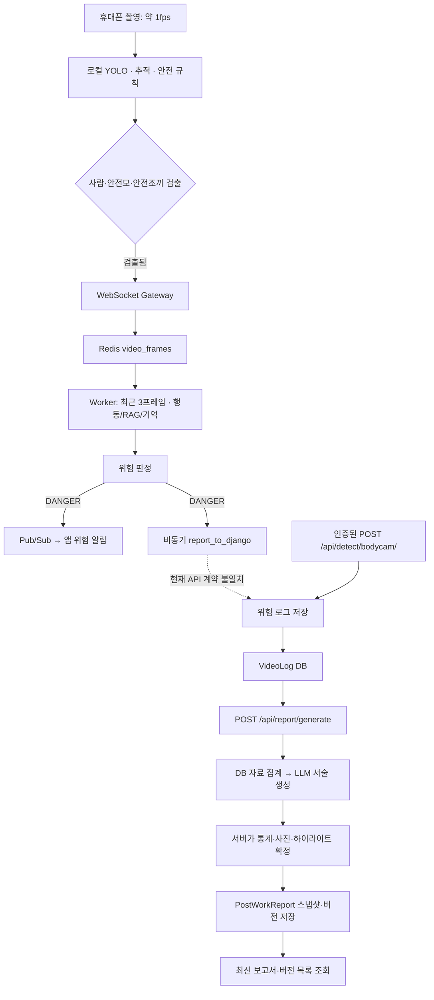

# 똑띠 테스트 파이프라인 및 위험 리포트 검증 보고서

작성·검증일: 2026-10-22. 대상: 현재 TTokTTi 작업 트리.

## 결론과 범위

이번 작업에서는 영상 처리 구간별 계측, 공개 2B 모델을 사용하는 실제 GPU 데모, 단기·장기 기억 비교, 위험 로그에서 작업 종료 보고서까지의 격리 검증을 수행했다.

**위험 알림, 위험 로그 저장, 종합 보고서 생성은 서로 다른 단계다. 현재 Worker의 기본 저장 요청과 Django 저장 API 사이에는 연결 불일치가 있다. 따라서 실제 휴대폰에서 위험이 발생하면 DB에 저장되고 종합 보고서까지 자동 생성된다는 종단 간 검증은 완료하지 못했다.**

기존 코드에 이미 있던 기능은 로컬 객체 필터, 메모리 압축, 위험 판정·알림, 위험 로그 API, 작업 종료 보고서 API다. 이번에 추가한 것은 계측·실험·검증 및 이 보고서이며, 기존 기능을 이번에 새로 구현했다고 표현하지 않는다. 커밋은 실제 작성 시각에 기능별로 나눈다.

## 현재 코드의 데이터 흐름



그림의 점선은 현재 연결이 완료됐다는 의미가 아니다. 이번 SQLite 테스트는 인증된 저장 API부터 보고서 DB 저장·조회까지를 검증하고, Worker의 HTTP 호출은 별도 MockTransport로 검증한다.

## 1. 휴대폰의 전송 필터

[CameraScreen](../frontend/mobile/src/screens/CameraScreen.tsx)은 촬영 → 640×640 입력 전처리 → 로컬 VisionEngine 분석 후, worker 모드에서 person/helmet/safety_vest 검출이 하나라도 있을 때 전송한다. [SafetyStream](../frontend/mobile/src/api/stream.ts)은 최대 초당 1회로 제한한다.

이 경로는 큰 화면 변화 또는 위험 이벤트에만 전송하는 정책이 아니다. 사람이 계속 검출되면 변화가 작아도 전송할 수 있다. 로컬 안전 이벤트 처리와 서버 전송 조건은 별개다.

원본 TFLite 파일과 Android 기기가 없어 이 필터의 전송 감소율, 로컬 처리 비용, 위험 누락률은 실측하지 못했다. 토끼 애니메이션을 사람·보호구 필터 정확도 평가에 사용하지 않았다.

## 2. 위험 상황에서의 알림과 저장 요청

[Worker](../vision_bodycam/worker.py)의 video_frames 경로는 다음 순서로 실행한다.

1. client_id별 최근 이미지 최대 3개와 상태를 갱신한다.
2. 처리 프레임 20개마다 행동을 인식하고 RAG 규칙을 갱신한다. 행동 기록이 5개가 되면 요약하여 장기 기억에 이어 붙인다.
3. [detect_danger](../vision_bodycam/core/inference.py)가 최근 프레임과 규칙으로 판정한다.
4. 위험이면 `alerts:{client_id}`에 DANGER를 발행한다. Gateway가 앱으로 전달하며 앱은 경고 UI를 표시한다.
5. `asyncio.create_task(report_to_django(...))`로 별도 HTTP 저장 요청을 시작한다.

비위험이면 DANGER와 보고 요청을 만들지 않는다. 추론 실패·빈 응답은 정상 SAFE로 취급하지 않도록 수정했다. 계측을 켠 프레임에는 안전/위험 모두 FRAME_RESULT를 반환하며 실패는 status=error로 구분한다.

**FRAME_RESULT의 status=ok는 프레임 분석 완료이며 DB 저장 성공이 아니다.** 비동기 저장 결과를 기다리지 않으므로 worker_total_ms에도 DB 저장 완료가 포함되지 않는다.

### 저장 연결에서 확인된 불일치

| 항목 | Worker·모바일 현재 동작 | Django가 제공하는 계약 |
|---|---|---|
| URL | 기본 `/api/incidents/` | `/api/detect/bodycam/`; `/api/incidents/` 미등록 |
| 인증 | `X-Internal-Key` | 바디캠 저장 API는 인증된 사용자 필요; 내부 키 헤더만으로는 인증되지 않음 |
| 정상 응답 | HTTP 201일 때만 성공 로그 | 바디캠 저장 API는 HTTP 200 |
| 필수 데이터 | 앱 CONFIG에 risk_type_id 없음, video_path는 빈 문자열 | worksession_id, BODY 유형 risk_type_id, video_path 필요 |
| client_id | 앱에 `AuthContext_user_id` 문자열이 고정됨 | 실제 사용자·세션 식별 연결 필요 |
| 실패 처리 | 오류 로그 후 종료 | 재시도·영속 재처리 큐·저장 완료 확인 연결 없음 |

환경변수로 URL만 바꾸는 것으로는 이 계약이 맞춰지지 않는다. HTTP 404/500/timeout의 경우 현재 함수는 로그만 남기며 재시도하지 않는 것을 격리 테스트로 확인했다. 인증된 테스트 요청은 VideoLog를 정상 저장했지만, 이것이 현재 모바일·Worker 경로의 연결 성공을 의미하지 않는다.

이번 마무리 범위에서는 계약을 새로 설계하거나 운영 저장 경로를 변경하지 않고, 확인된 상태를 보고한다.

## 3. 위험 로그에서 작업 종료 보고서가 만들어지는 과정

위험 로그 저장 API는 [bodycam_risk](../backend/apps/detect/views.py)다. 인증과 필수 필드를 검사하고 BODY 위험 유형인지 확인한 뒤 VideoLog를 source=AUTO로 저장한다. 이미지 파일 자체를 이 API가 생성·업로드하지는 않는다. 요청에 있는 증거 영상 경로를 저장한다.

종합 보고서는 [generate_postwork_report](../backend/apps/report/views.py)가 `POST /api/report/generate` 요청을 받을 때 생성한다. 위험 이벤트마다 자동으로 호출되는 구조는 아니다. [웹 ReportScreen](../frontend/web/src/screens/ReportScreen.tsx)은 생성 버튼을 누르거나, DONE 세션의 최신 보고서 조회가 404인 경우 생성 요청을 보낸다.

보고서 생성 순서는 다음과 같다.

1. [build_input_package](../backend/apps/report/services.py)가 작업 세션·현장·참여자·전후 사진·보호구 준수 기록·VideoLog를 조회한다.
2. 위험 유형이 있는 로그의 유형별·카메라별·수동 조치 상태 통계를 집계한다.
3. 기본 60초 창에 위험 로그 3건 이상이 모이면 하이라이트 후보를 만들고, 간격 30초 이내 구간을 병합한다. 병합 중 중복 로그는 ID로 제거하고 대표 증거를 최대 3건 담는다.
4. [generate_report_json](../backend/apps/report/llm.py)이 DB 자료를 `gpt-4o-mini`에 보내 JSON 서술을 요청한다. 실제 호출에는 OPENAI_API_KEY가 필요하다.
5. 서버가 생성 시각, 전후 사진 경로, 위험 통계, 준수 통계, 위험 하이라이트를 DB 집계값으로 덮어쓴다. 해당 필드의 숫자·경로를 LLM 출력에 맡기지 않는다.
6. [PostWorkReport](../backend/apps/report/models.py)에 input_snapshot과 report_snapshot을 저장하고 세션별 버전을 증가시킨다.
7. `GET /api/report/{worksession_id}/latest`와 `/versions`에서 최신 결과와 이력을 조회한다.

기억 압축의 long_term_memory는 현재 이 보고서 생성 입력에 직접 들어가지 않는다. 이 보고서는 DB에 저장된 자료를 사용한다. 분석 모델의 기억과 보고서의 저장 기록을 동일한 데이터로 설명하면 안 된다.

### 보고서 검증 결과

임시 SQLite DB와 실제 Django 모델·뷰·시리얼라이저·집계 함수를 사용했다. 외부 LLM 응답만 테스트용 JSON으로 대체했다.

- 인증된 바디캠 위험 로그 3건을 저장했고 source=AUTO를 확인했다.
- 로그 저장 직후에는 PostWorkReport가 0건임을 확인했다.
- 보고서 생성 후 통계 total=3, 하이라이트 1개/count=3, 안전모 미준수 1건, 작업 전 사진 경로가 반영됐다.
- 테스트 LLM이 잘못 반환한 total=999와 가짜 사진·하이라이트가 실제 DB 자료로 덮어써졌다.
- 입력·결과 스냅샷이 DB에 저장됐고 재생성 시 버전 1 → 2, 최신 조회 및 버전 내림차순 조회를 확인했다.
- 인증 누락, 위험 유형 누락, FULL 유형을 BODY API에 보내는 경우 저장을 거부했다.
- LLM 오류 시 보고서를 저장하지 않았다. 현재 API에는 이 오류를 전용 FAILED 응답으로 바꾸는 처리까지는 없다.
- 빈 작업 세션은 위험 통계 0건, 하이라이트 없음으로 집계하고, 아직 없는 보고서는 404를 반환했다.

[테스트 생성 예시 JSON](../performance-results/report-pipeline-fixture.json)은 가상의 위험 로그와 LLM stub으로 만든 검증 산출물이다. 실제 위험 탐지 또는 외부 LLM이 작성한 현장 보고서가 아니다.

## 4. 실제 GPU 성능 측정 결과

### 브라우저 → Gateway → Redis → 공개 2B 모델

[원시 결과](../performance-results/browser-demo-20261022.json), [측정 조건](browser-latency-demo.md).

| 조건 | 표본 수 | 응답 p50 | 응답 p95 | 주요 구간 |
|---|---:|---:|---:|---|
| 클라이언트 1개 | 10 | 2.04초 | 2.51초 | 모델 생성 약 2.01초 |
| 클라이언트 3개 | 15 | 5.78초 | 6.07초 | 큐 대기 약 3.75초 |

모델 로딩 42.10초, 첫 요청 7.83초는 워밍업 이후 통계와 구분했다. 요청마다 이전 응답을 기다리는 closed-loop 방식이고 표본이 작다. 휴대폰·원본 8B 모델·산업안전 정확도의 측정값은 아니다.

### 실제 영상의 단기·장기 기억 비교

[원시 결과](../performance-results/memory-video-20261022.json), [상세 보고서](memory-video-benchmark.md).

Big Buck Bunny 영상에서 관찰 30개를 만들고 5개마다 기존 compress_memory()로 장기 기억에 요약했다. 5·10·20·30개 시점에서 동일 질문을 조건별 3회 비교했다.

| 관찰 30개 시점 | 누적 | 압축 |
|---|---:|---:|
| 입력 토큰 | 1,614 | 588 |
| 첫 토큰까지: 32토큰 고정 조건 | 255ms | 124ms |
| 32토큰 고정 전체 추론 | 1.45초 | 1.30초 |
| 자연 답변 전체 추론 | 4.13초 | 3.30초 |

입력 63.6%, 고정 출력 지연 10.2%가 줄었다. 자연 답변은 출력 길이가 달라 20.1% 감소를 순수 입력 압축 효과로 해석하면 안 된다.

요약 6회에 11.25초가 들었다. 공통 관찰 비용과 질문 4회 중앙값을 합산하면 누적 76.88초, 압축 82.51초다. 이 질문 빈도에서는 응답은 빨라져도 총 처리 비용은 증가했다. 요약 2건이 60토큰 상한에 도달했고, 정보 보존 정확도는 평가하지 않았다.

## 5. 테스트 목록과 재현

| 검증 | 결과 | 실제 사용한 구성 | 대체·제외한 구성 |
|---|---|---|---|
| Python 계측·판정·저장 호출 | 10개 통과 | Gateway/Worker 코드, WebSocket TestClient, HTTP 클라이언트 | Redis·모델·HTTP 서버 stub |
| TypeScript 계측 | 4개 통과 | 계측 및 SafetyStream 코드 | React Native·WebSocket stub |
| Django 보고서 파이프라인 | 5개 통과 | 실제 뷰·집계·모델·임시 SQLite DB | 외부 LLM stub, 운영 설정·MySQL 제외 |
| 브라우저 GPU 측정 | 25회 + 워밍업 1회 성공 | 실제 Chrome·Gateway·Redis·GPU | 원래 모바일·8B 경로 제외 |
| 기억 압축 비교 | 30개 관찰·6회 요약·자연 답변 24회·고정 출력 24회 완료 | 실제 영상·GPU, 기존 압축·질문 함수 | 로컬 모델 어댑터; 네트워크 제외 |
| 브라우저 UI 확인 | 통과 | 업로드·실제 분석·JSON 저장·영상 탐색·결과 화면 | Android UI 제외 |

Django 테스트는 운영 DB·외부 API를 호출하지 않는다. 현재 테스트 URLconf는 실제 detect/report 앱 경로만 포함한다. 기본 Worker URL의 부재는 실제 최상위 앱 URL 선언을 별도로 검사했다. 전체 운영 라우팅·인증 인프라를 통합 실행한 것은 아니다.

```bash
cd /home/user0/projects/nice-check/TTokTTi

# 기존 계측 및 Worker HTTP 요청 계약
/tmp/ttoktti-runtime/venv/bin/python -m unittest discover -s tests/latency -v

# 실제 Django 모델/뷰 + 일회성 메모리 DB
# 별도 환경에서는 먼저 tests/report_pipeline/requirements.txt 설치
/tmp/ttoktti-runtime/venv/bin/python tests/report_pipeline/run.py

# TypeScript 계측 코드 컴파일 및 테스트
node /path/to/typescript/bin/tsc \
  -p frontend/mobile/telemetry-tests/tsconfig.json \
  --outDir /tmp/ttoktti-latency-tests
TTOKTTI_LATENCY_BUILD=/tmp/ttoktti-latency-tests \
  node --test frontend/mobile/telemetry-tests/latency.test.cjs
```

GPU 실험 재실행과 Chrome 검사 환경변수는 [브라우저 문서](browser-latency-demo.md), [기억 비교 문서](memory-video-benchmark.md)를 따른다. 이번 마무리에서는 모델·실험 조건을 바꾸지 않아 이미 완료한 GPU 벤치마크를 다시 실행하지 않았다.

## 6. 남은 검증과 데모 순서

운영 연결을 완성하려면 실제 사용자/세션 식별, 위험 유형 매핑, 증거 영상 경로, 서비스 인증, 저장 성공 확인 및 재시도를 먼저 맞춰야 한다. 이후 실제 Android·원본 YOLO·8B 모델·Django 저장까지 연결해서 위험 발생→알림→로그 저장→보고서 조회를 확인해야 한다.

보고서 API의 동시 버전 생성 경쟁, 접근 권한, LLM 결과 스키마 오류·외부 실패에 대한 운영 처리는 이번 테스트 범위를 넘는다. 메모리 압축에 따른 사실 누락률, 전송 필터별 위험 누락률, 7B/8B 효과도 아직 측정하지 않았다.

데모는 다음 순서로 진행한다.

1. [브라우저 실측](http://localhost:8892)에서 이미지 한 장을 보내고 큐·모델 생성·전체 응답 시간을 설명한다.
2. [기억 비교](http://localhost:8892/memory)에서 원본 영상, 5/10/20/30개 기록, 누적/압축 입력과 답변을 비교한다.
3. 이 보고서의 연결도를 보여주며 위험 알림과 영속 로그·종합 보고서의 차이를 설명한다.
4. `tests/report_pipeline/run.py`를 실행하고 테스트 생성 예시 JSON에서 위험 집계와 버전 저장을 보여준다. LLM stub임을 밝힌다.
5. 실제 휴대폰·원본 모델과 Worker→Django 계약 연결은 미완료라고 설명한다.
